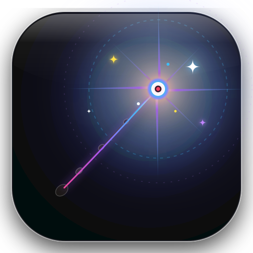

# 🟣 Loomus Studio

<p align="center">
  
</p>

<p align="center">
  <b>La alternativa de código abierto, moderna y 100% privada a Loom para macOS y Apple Silicon.</b><br>
  Graba tu pantalla, tu cámara web en una burbuja flotante y dibuja en vivo con efectos neón — sin límites de tiempo y sin subir tus videos a la nube.
</p>

<p align="center">
  <a href="#-características-principales"></a>
  <a href="#-compatibilidad-y-arquitectura"></a>
  <a href="LICENSE"></a>
  <a href="SECURITY.md"></a>
  
</p>

---

## ⚡ ¿Por qué Loomus? (Loomus vs Loom)

Loom revolucionó la comunicación asíncrona, pero impone dos grandes barreras: **cuesta \$12.50-\$15 USD mensuales por usuario** y **obliga a subir cada grabación a servidores en la nube**, lo que representa un riesgo crítico de privacidad para desarrolladores, abogados, médicos y empresas que manejan información confidencial.

| Característica | 🟣 Loomus Studio | 🔴 Loom (Plan Free/Starter) |
| :--- | :--- | :--- |
| **Precio** | **100% Gratis y Open Source** | $12.50 – $15.00 USD / mes |
| **Privacidad de Video** | **100% Local-First** (El video nunca sale de tu Mac) | Subido y almacenado en servidores externos |
| **Límite de tiempo** | **Ilimitado** | Limitado a 5 minutos en plan gratuito |
| **Anotaciones en Pantalla** | **6 herramientas neón integradas en vivo** | Solo en planes de pago |
| **Teleprompter Integrado** | **Incluido** con modo invisible para el espectador | Requiere complementos de terceros |
| **Auditoría de Código** | **Código abierto transparente (Cero spyware)** | Código cerrado propietario |
| **Aceleración por Hardware** | **Apple Silicon (M1/M2/M3/M4)** | Basado en streaming web |

---

## ✨ Características Principales

- 🖊️ **Motor de Anotaciones en Vivo (Live Inking):** Dibuja directamente sobre lo que estás grabando sin pausar el video.
  - ✏️ **Lápiz libre:** Trazos precisos y fluidos en 60 FPS.
  - ✨ **Tinta efímera (Vanishing Ink):** Se desvanece suavemente tras 2.5 segundos (ideal para señalar detalles sin ensuciar la pantalla).
  - 🖍️ **Resaltador translúcido:** Destaca textos y código sin tapar el contenido.
  - ➡️ **Flechas vectoriales inteligentes:** Apunta con precisión con puntas auto-orientadas.
  - 🔲 **Marcos de enfoque:** Delimita zonas de atención.
  - 🔍 **Cursor Spotlight (Linterna):** Enfoque circular dinámico con máscara oscura para concentrar la atención del espectador.
  - 🎨 **Paleta Neón:** 5 colores de alto contraste (Cian, Rosa neón, Amarillo ámbar, Verde esmeralda y Blanco puro).

- 🎛️ **Selector de 3 Modos de Captura:**
  - 🖥️ + 🎥 **Pantalla + Cámara:** Graba tu escritorio o ventana activa junto con tu cámara flotante.
  - 🖥️ **Solo Pantalla:** Máxima concentración en tu contenido técnico o tutorial.
  - 🎥 **Solo Cámara:** Modo presentación y avatar en pantalla completa o retrato.

- 💬 **Burbuja de Cámara Flotante:**
  - Posicionable en cualquier esquina de tu pantalla.
  - Espejo horizontal (Flip horizontal) y recorte circular perfecto con borde luminoso.
  - No obstruye las ventanas de tu sistema gracias a su modo flotante `alwaysOnTop`.

- 📜 **Teleprompter Integrado Invisible:**
  - Lee tus notas o guion mientras grabas.
  - Ajuste de tamaño de fuente, velocidad de scroll automático y opacidad.
  - **Protección de contenido macOS:** Utiliza `setContentProtection(true)` para que tus notas **nunca aparezcan en el video final**.

- 🔒 **Garantía de Privacidad 100% Local-First:**
  - Ningún fotograma, audio o metadato se transmite a ningún servidor de internet.
  - Puedes utilizar Loomus completamente desconectado de internet (modo avión).

---

## 📥 Instalación

### Opción 1: Descargar el Instalador Oficial (.dmg)
1. Ve a la sección de [Releases](https://github.com/lemustech/loomus/releases) del repositorio.
2. Descarga **`Loomus Studio-arm64.dmg`**.
3. Haz doble clic en el `.dmg` y arrastra **Loomus Studio** hacia tu carpeta **Applications**.
4. ¡Listo! Ya puedes abrirla desde tu Launchpad o Spotlight.

> **Nota de Seguridad en macOS:** Como Loomus utiliza firma de código ad-hoc de código abierto, la primera vez que lo abras macOS puede pedirte confirmar: ve a *Ajustes del Sistema > Privacidad y Seguridad* y haz clic en *Abrir de todos modos*.

---

## 🛠️ Compilación y Desarrollo Local

Si deseas auditar el código o compilar el binario tú mismo:

### Prerrequisitos
- Mac con procesador Apple Silicon (M1, M2, M3 o M4) o Intel Mac.
- macOS 13.0 (Ventura), macOS 14 (Sonoma), macOS 15 (Sequoia) o superior.
- Node.js 18+ instalado.

### 1. Clonar el repositorio
```bash
git clone https://github.com/lemustech/loomus.git
cd loomus
```

### 2. Instalar dependencias
```bash
npm install
```

### 3. Ejecutar en modo desarrollo
```bash
npm start
```

### 4. Compilar la App Nativa y generar el instalador DMG
```bash
npm run build:mac
```
El script generará automáticamente los binarios firmados en la carpeta `dist/`:
- `dist/Loomus Studio.app`
- `dist/Loomus Studio-arm64.dmg`

---

## 🏛️ Arquitectura del Proyecto

```
loomus/
├── build/
│   ├── entitlements.mac.plist   # Permisos de hardware de Apple (cámara, micrófono, V8 JIT)
│   └── icon.icns                # Contenedor de íconos multirresolución Retina
├── dist/                        # Binarios compilados (.app y .dmg)
├── scripts/
│   └── build-mac.js             # Pipeline automatizado de empaquetado, firma y DMG
├── src/
│   ├── main/
│   │   ├── main.js              # Proceso principal: ventanas, ScreenCaptureKit, IPC y permisos
│   │   └── preload.js           # Puente seguro entre Node.js y el motor web
│   └── renderer/
│       ├── index.html           # Interfaz de usuario, docks y canvas de composición
│       ├── styles.css           # Estilos oscuros de lujo y paleta neón
│       ├── app.js               # Motor de grabación a 60 FPS y lienzo de dibujo en vivo
│       └── assets/              # Logotipos vectoriales
├── LICENSE                      # Licencia MIT
├── SECURITY.md                  # Manifiesto de privacidad y seguridad local
└── package.json
```

---

## 🤝 Contribuciones

Las contribuciones son bienvenidas. Si tienes una idea para mejorar el motor de dibujo, agregar nuevos atajos de teclado o mejorar el teleprompter:
1. Haz un Fork del proyecto.
2. Crea tu rama de características (`git checkout -b feature/nueva-mejora`).
3. Haz commit de tus cambios (`git commit -m 'feat: agregar nuevo modo de dibujo'`).
4. Haz push a tu rama (`git push origin feature/nueva-mejora`).
5. Abre un Pull Request.

---

## 📄 Licencia

Este proyecto está bajo la Licencia **MIT**. Consulta el archivo [LICENSE](LICENSE) para más detalles.

Autor: **Luis Lemus** ([@luislemus](https://github.com/luislemus))
